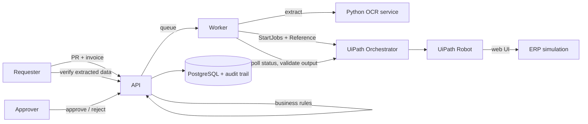

# Orchestra AI

**Intelligent enterprise automation platform** — business workflow orchestration, document intelligence,
tiered approval and **UiPath** robotic process automation for one complete, reliable flow:
**Purchase Request → Purchase Order**.

Orchestra AI owns the business process (rules, approvals, workflow state, audit trail). UiPath is the
exclusive RPA execution engine that enters the purchase order in an ERP. A Python service reads the
supplier invoice. Every decision is made or confirmed by a human; every state change is audited.



## Highlights

* **Explicit workflow state machine** (12 statuses from the PRD) with compare-and-set transitions; every
  transition writes an append-only audit event (UPDATE/DELETE on `audit_logs` are rejected by a DB trigger).
* **Document intelligence** (FastAPI): PDF text layer first, Tesseract OCR for scans, Indonesian/English
  invoice parsing, per-field confidence and cross-checks (qty × price, subtotal + tax = total).
  Low-confidence fields must be explicitly confirmed by the requester. AI never approves anything.
* **Configurable business rule engine**: completeness, supplier validity, quantity limits, amount range,
  monthly department budget, duplicate invoices, required date, approval thresholds
  (≤ 5,000,000 → department; above → department + finance). Workflow configuration is versioned;
  requests keep the version they started with.
* **Tiered approval** with segregation of duties: eligible approvers only, never your own request,
  the same person cannot approve two levels.
* **UiPath integration adapter** (OAuth client credentials, release lookup, `StartJobs` with a per-attempt
  `Reference`, status polling, output validation, `StopJobs` on timeout).
* **Reliability**: one automation job per request (unique constraints), idempotency key passed to the
  ERP, reference lookup before any resubmission (a timeout is never assumed to mean "not submitted"),
  automatic retries only before the robot starts, bounded operator retries, restart reconciliation.
* **Security**: server-side sessions (HttpOnly, SameSite) with argon2id passwords, account lockout,
  login rate limiting, backend RBAC + data scoping (own / assigned / all), origin check, upload
  validation by magic bytes, secrets only on the server.

## Repository layout

```text
apps/
  api/          NestJS API (modular monolith): auth, users, workflows, purchase requests, documents,
                business rules, approvals, automation, notifications, audit, dashboard, integrations
  worker/       BullMQ worker: document processing, UiPath submission/polling, reconciliation
  web/          Next.js 16 + Tailwind + shadcn-style UI
packages/
  domain/       Pure TypeScript: state machines, rule engine, RBAC policy, robot contract (unit tested)
  database/     Prisma schema, migrations (incl. audit trigger), seed
  core/         Shared server services: transitions, audit, queues, document processing,
                automation executor, reconciler
  uipath-client/UiPath Orchestrator adapter (RpaExecutionProvider)
services/
  document-intelligence/     Python FastAPI service (OCR + parsing + confidence)
  erp-simulation/            SimERP web app the robot operates (idempotent PO creation)
  uipath-orchestrator-mock/  DEVELOPMENT ONLY Orchestrator mock with a simulated robot
uipath/PurchaseOrderAutomation/  UiPath Studio project (hand-authored, see its README)
tests/e2e/      Playwright end-to-end tests through the web UI
samples/invoices/  Synthetic invoices for demos (PDF + a scanned PNG)
docs/           Architecture, UiPath integration, testing, deployment, case study
```

## Quick start (Docker Compose)

Requirements: Docker Desktop (or Docker Engine + Compose v2).

```bash
docker compose up --build
```

Open <http://localhost:3000>. Services: web `:3000`, API `:4000` (OpenAPI at
<http://localhost:4000/api/v1/docs>), ERP simulation `:4100`, Orchestrator mock `:4200`.
The `migrate` container applies the migrations and seeds demo data on every start (idempotent).

By default UiPath is the **development mock**: its simulated robot fills the ERP simulation's web
form through HTTP. To use a real UiPath tenant see [docs/uipath-integration.md](docs/uipath-integration.md).

## Local development without Docker

Useful when Docker is not available. The API runs the background jobs in-process
(`QUEUE_DRIVER=inline`, development only; production uses BullMQ + Redis and `apps/worker`).

```bash
pnpm install
cp .env.example .env            # then set DATABASE_URL and QUEUE_DRIVER=inline
pnpm build
pnpm db:migrate && pnpm db:seed
```

A PostgreSQL is needed: Docker (`docker compose up -d postgres`), a local install, or Prisma's local
server `npx prisma dev` (from `packages/database`; add `&pgbouncer=true` to its TCP URL). Then start,
each in its own terminal:

```bash
pnpm dev:erp
```

```bash
pnpm dev:uipath-mock
```

```bash
pnpm dev:api
```

```bash
pnpm dev:web
```

and the Python service (Python ≥ 3.11):

```bash
cd services/document-intelligence && python -m venv .venv && .venv/Scripts/pip install -e ".[dev]" && .venv/Scripts/uvicorn app.main:app --port 8000
```

(On macOS/Linux use `.venv/bin/`. Set `DOCUMENT_INTELLIGENCE_TOKEN` to the same value as in `.env`.)

## Demo accounts

Created by the seed for development; the password is `SEED_DEFAULT_PASSWORD` from `.env` /
`docker-compose.yml`. Change it for anything shared.

| Email | Role | Department |
|---|---|---|
| requester@orchestra.local | Requester | Operations |
| requester.it@orchestra.local | Requester | IT |
| approver.ops@orchestra.local | Approver (department) | Operations |
| approver.it@orchestra.local | Approver (department) | IT |
| approver.finance@orchestra.local | Approver (finance) | Finance |
| operator@orchestra.local | Automation operator | IT |
| admin@orchestra.local | Administrator | IT |
| viewer@orchestra.local | Management / viewer | Finance |

## Demo walkthrough

1. **Requester** → *New request*, upload `samples/invoices/invoice-sinar-jaya-idr.pdf`, *Create & submit*.
2. Document intelligence extracts supplier, invoice number, date, items and totals with confidence
   scores. Check the values, confirm any low-confidence field, *Verify & send for approval*.
   The business rules run and choose the approval route (Rp 2,664,000 → department approver).
3. **approver.ops** → *Approvals* → *Approve*.
4. The worker submits the UiPath job; the robot creates the PO in SimERP; the request shows
   **PO-YYYY-NNNNNN** within seconds. The timeline lists every transition.
5. Try `invoice-teknologi-nusantara-idr.pdf` (Rp 12.7 M → department **and** finance approval),
   `invoice-global-office-usd.pdf` (USD converted for thresholds) or
   `invoice-mitra-lama-blocked-supplier.pdf` (inactive supplier → blocked by the rules).
6. Failure handling: inject a robot failure in the mock, e.g.
   `curl -X POST localhost:4200/__mock/scenarios -H "X-Mock-Admin-Token: dev-mock-admin-change-me" -H "Content-Type: application/json" -d "{\"mode\":\"fault-after-erp\"}"`,
   approve a request, then as **operator** open *Automation jobs* and *Retry*: the ERP returns the
   existing PO for the same idempotency key, so no duplicate is created. Other modes:
   `fault`, `business-error`, `robot-unavailable`, `submit-timeout`, `submit-error`.

## Tests

| Suite | Command | Uses |
|---|---|---|
| Domain, core, adapter, ERP, mock unit tests | `pnpm test` | no external services |
| API integration (19 tests) | `TEST_DATABASE_URL=… pnpm test:integration` | real PostgreSQL, **mocked UiPath**, stubbed OCR, in-process queue |
| Worker BullMQ tests | `REDIS_URL=… pnpm --filter @orchestra/worker test:integration` | real Redis |
| Python service (41 tests) | `cd services/document-intelligence && pytest` | generated PDFs; OCR test needs Tesseract |
| End-to-end (Playwright, 4 tests) | `pnpm test:e2e` (`PW_CHANNEL=msedge` to use installed Edge) | full stack through the UI, **mocked UiPath** |

No test in this repository talks to a real UiPath tenant; see [docs/testing.md](docs/testing.md)
for exactly what is mocked and what has been verified.

## MVP definition of done (PRD §21)

| # | Criterion | Status |
|---|---|---|
| 1 | Login per role | Done (sessions, RBAC, lockout) |
| 2 | Requester creates purchase requests | Done |
| 3 | Documents uploaded and processed | Done (PDF text layer verified; OCR path needs Tesseract, included in Docker) |
| 4 | Extraction can be verified | Done (low-confidence acknowledgement enforced server-side) |
| 5 | Business rule validation | Done |
| 6 | Approve / reject | Done (sequential levels, segregation of duties) |
| 7 | Approved requests sent to UiPath | Done against the Orchestrator API contract; verified with the mock |
| 8 | UiPath robot creates the PO in the ERP simulation | Robot project provided; **not yet run in UiPath Studio/Robot** |
| 9 | Job status monitored from Orchestra | Done |
| 10 | Failures handled and retried safely | Done (automatic + operator retries, reconciliation) |
| 11 | No duplicate PO from tested retries | Done (integration + E2E tests, mocked UiPath) |
| 12 | Critical activity audited | Done (append-only, DB-enforced) |
| 13 | RBAC tested | Done (integration + E2E) |
| 14 | Documentation and deployment guide | Done ([docs/](docs)) |

## Documentation

* [docs/architecture.md](docs/architecture.md) — modules, state machines, reliability design, data model
* [docs/uipath-integration.md](docs/uipath-integration.md) — connecting a real Orchestrator tenant
* [docs/testing.md](docs/testing.md) — test strategy and verified results
* [docs/deployment.md](docs/deployment.md) — configuration and production notes
* [docs/case-study.md](docs/case-study.md) — portfolio case study
