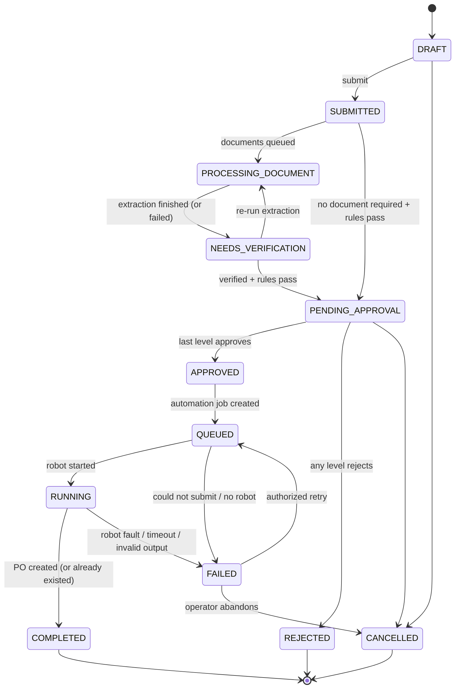
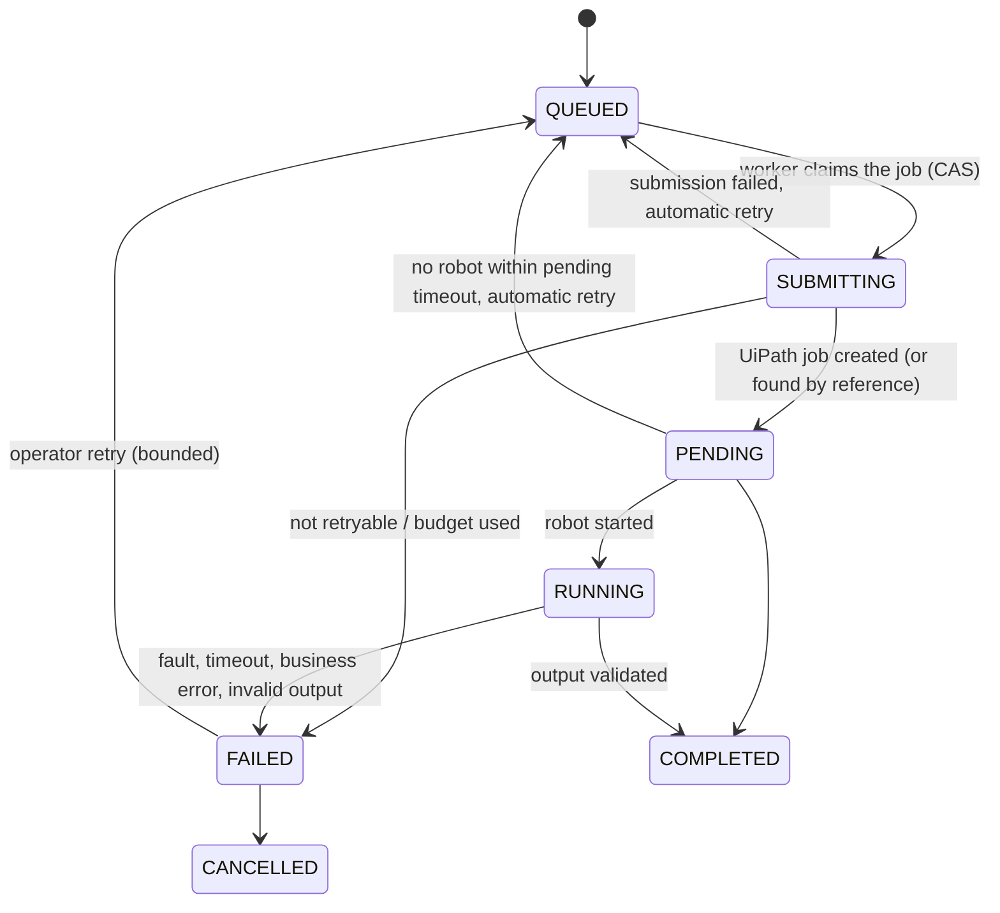
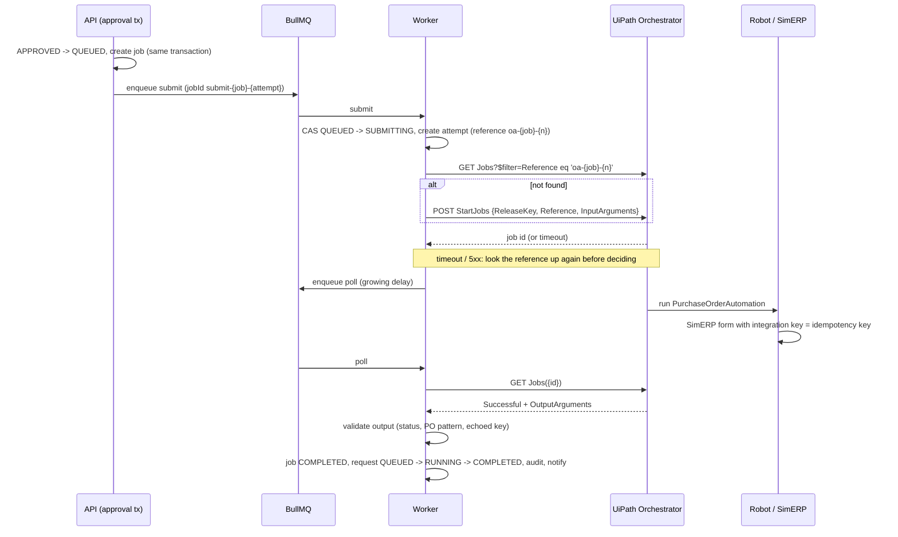
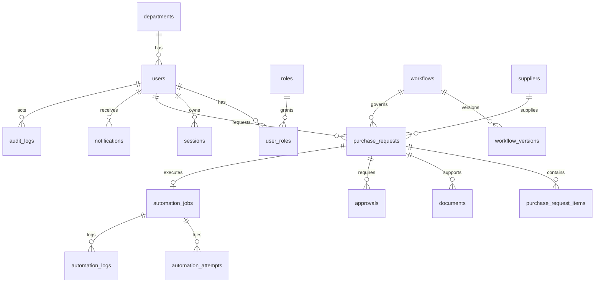

# Architecture

Orchestra AI is a **modular monolith with asynchronous background processing** (SAD §10). One NestJS
API owns all business decisions; a separate worker process executes slow or external work from
BullMQ queues; PostgreSQL is the single source of truth.

## Components

| Component | Technology | Responsibility |
|---|---|---|
| `apps/web` | Next.js 16, React 19, Tailwind 4, TanStack Query | UI; same-origin proxy (`/api/v1/*`) to the API so the HttpOnly session cookie never crosses origins |
| `apps/api` | NestJS 11, Prisma 6 | Authentication, RBAC, workflow state, business rules, approvals, automation commands, audit, dashboard, OpenAPI |
| `apps/worker` | NestJS application context, BullMQ 5 | Document processing, UiPath submission and polling, reconciliation after restarts |
| `packages/domain` | TypeScript (no I/O) | State machines, rule engine, RBAC policy, robot contract, idempotency helpers — shared by API, worker and web |
| `packages/core` | TypeScript + Prisma | Shared server services: transitions with audit, queues, document processing, automation executor, reconciler |
| `packages/uipath-client` | TypeScript | The UiPath Orchestrator adapter (`RpaExecutionProvider`) |
| `packages/database` | Prisma, PostgreSQL | Schema, migrations, append-only audit trigger, seed |
| `services/document-intelligence` | Python 3.12, FastAPI, pypdf, Tesseract | Text extraction, invoice parsing, confidence scoring |
| `services/erp-simulation` | Express, SQLite | SimERP: web UI the robot operates; idempotent purchase order creation |
| `services/uipath-orchestrator-mock` | Express | Development/test stand-in for Orchestrator with a simulated robot |
| `uipath/PurchaseOrderAutomation` | UiPath Studio project | The real robot process |

Module boundaries inside the API follow the PRD modules: `auth`, `users`, `reference-data`,
`workflows`, `purchase-requests`, `documents`, `business-rules`, `approvals`, `automation`,
`notifications`, `audit`, `dashboard`, `integrations`.

## Purchase request lifecycle

Rules enforced by `transitionPurchaseRequest` (`packages/core/src/workflow/transitions.ts`):

* the edge must exist in `PURCHASE_REQUEST_TRANSITIONS` (`packages/domain`);
* the update is a compare-and-set on the expected current status, so concurrent actors cannot both
  apply a transition (the loser receives `409 CONFLICT`);
* the audit event is written in the same database transaction.

When the system observes an external state that skipped a status (a robot finished between two
polls), it walks the intermediate transitions so the audit trail stays complete.

## Automation job lifecycle

An **automation job** is "create the PO for this request". It can span several UiPath **attempts**
(job submissions). `automation_jobs.purchase_request_id` and `idempotency_key` are unique: a request
can never get a second job.

### Submission and monitoring

### Retry policy

| Situation | Classification | Behaviour |
|---|---|---|
| Orchestrator unreachable, 5xx, 429 while submitting | before start, retryable | queue-level retry, then automatic resubmission up to `maxAutoAttempts` |
| `StartJobs` timed out / connection reset | **ambiguous** | look the reference up; adopt the job if it exists; otherwise resubmit |
| Worker crashed mid-submission | ambiguous | reconciler finds `SUBMITTING` older than the lease and resolves it by reference |
| No robot picked the job up (`pendingTimeoutMinutes`) | before start, retryable | `StopJobs` + automatic resubmission |
| Robot faulted (system exception) | after start | `FAILED`; operator may retry |
| Robot returned `BUSINESS_ERROR` / ERP rejected data | after start, not retryable | `FAILED`; operator decides (retry or abandon) |
| Running longer than `executionTimeoutMinutes` | after start | `StopJobs` (Kill) + `FAILED` |
| Output invalid (missing PO, wrong idempotency key) | after start | `FAILED`; verify in the ERP before retrying |
| `attemptCount >= maxTotalAttempts` | — | retry refused (`RETRY_LIMIT_REACHED`), `requiresIntervention = true` |

Why retries never duplicate purchase orders, in layers:

1. one job per request (unique constraints), CAS state transitions;
2. one Orchestrator reference per attempt, checked before (re)submitting;
3. the idempotency key typed into SimERP's *Integration key*; SimERP has a `UNIQUE` constraint on it and
   answers `ALREADY_EXISTS` with the original PO number, which Orchestra accepts as success.

### Restart recovery (reconciler)

Queue messages can be lost (Redis restart, crash between commit and enqueue). The reconciler runs at
worker start and every `RECONCILE_INTERVAL_MS` and re-creates work from PostgreSQL:

* `QUEUED` jobs not touched for 30 s (and due) → submit message;
* `SUBMITTING` jobs older than the lease → submit message (resolved by reference lookup);
* `PENDING` / `RUNNING` jobs not polled for 90 s → poll message;
* documents stuck in `QUEUED` / `PROCESSING` → processing message;
* requests stuck in `PROCESSING_DOCUMENT` with no pending document → `NEEDS_VERIFICATION`.

Reconciler messages use distinct, time-bucketed job ids; every handler is idempotent, so duplicates are
harmless.

## Document intelligence

1. File type detected from magic bytes (API and Python service), size limit per workflow.
2. PDF text layer via `pypdf` (layout mode); if there is no text layer, pages are rendered with
   `pypdfium2` and read with Tesseract (`eng+ind`). Images go straight to OCR.
3. Rule-based parser: labelled fields (invoice number, date, supplier, currency), buyer block and due
   date are ignored, item rows parsed from the right (`description qty [unit] price total`),
   Indonesian and English number/date formats.
4. Confidence: base confidence per extraction path × OCR line confidence, adjusted by cross-checks
   (qty × price = line total, Σ lines = subtotal, subtotal + tax = total). Fields below the workflow's
   `confidenceThreshold` are flagged; the API refuses verification until the requester confirms them.

The extraction is stored on the document; the purchase request is only changed by the human
verification step.

## Data model (core tables)

UUID primary keys everywhere; indexes on request number, status, requester, created date, UiPath job id
and audit lookups. Money is `numeric(18,2)` and computed in minor units in code.

## Security model

* **Authentication**: opaque random session token in an HttpOnly, SameSite=Lax cookie; only its SHA-256
  hash is stored. Sessions are revoked on logout, deactivation and password change.
* **Passwords**: argon2id (m = 19 MiB, t = 2, p = 1); policy ≥ 12 characters with letters and digits;
  lockout after repeated failures; login rate limit; identical errors for unknown users and bad passwords.
* **Authorization**: global guards — every route requires a session unless `@Public()`, and
  `@RequirePermissions` is checked on the server. Data scoping (own / assigned / all) is applied in
  queries; requests outside the scope return 404.
* **CSRF**: SameSite cookies plus an origin check for state-changing requests.
* **Uploads**: content sniffing, extension check, size limits, generated storage paths, `nosniff` on download.
* **Secrets**: UiPath and service credentials only in server environment variables; tokens are cached in
  memory by the adapter and never returned by any endpoint. Audit payloads redact secret-looking keys.
* **Audit**: `audit_logs` is append-only (application writes only inserts; a trigger rejects UPDATE/DELETE).
